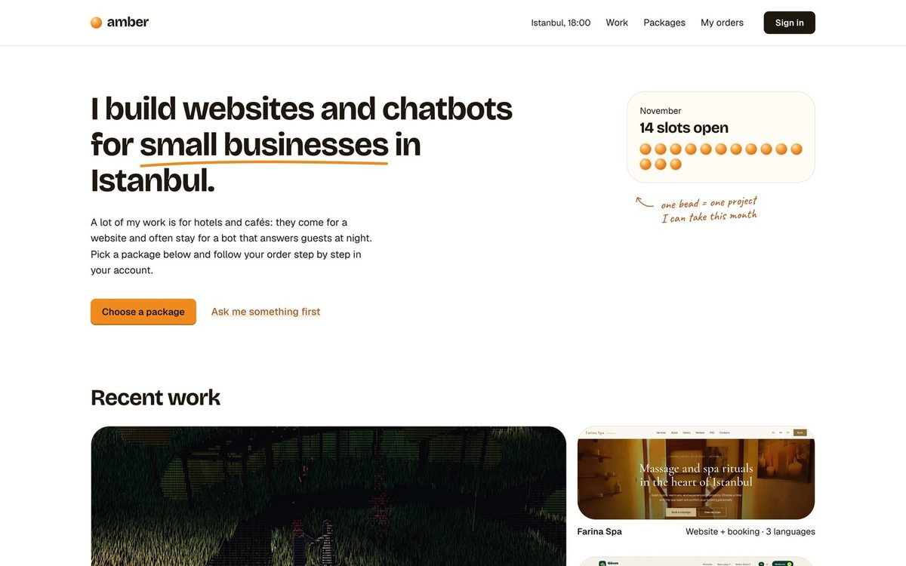
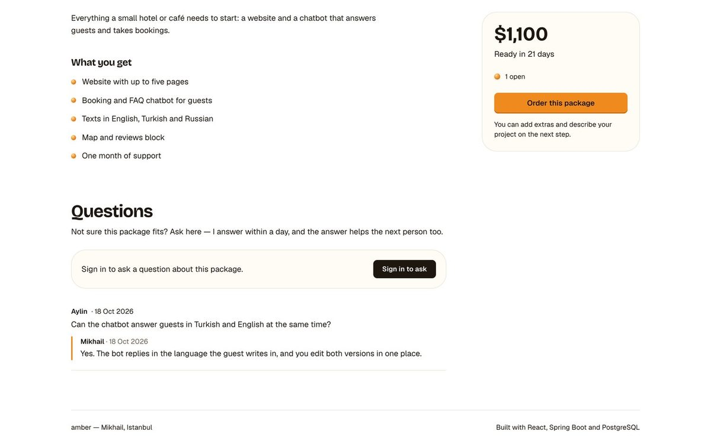
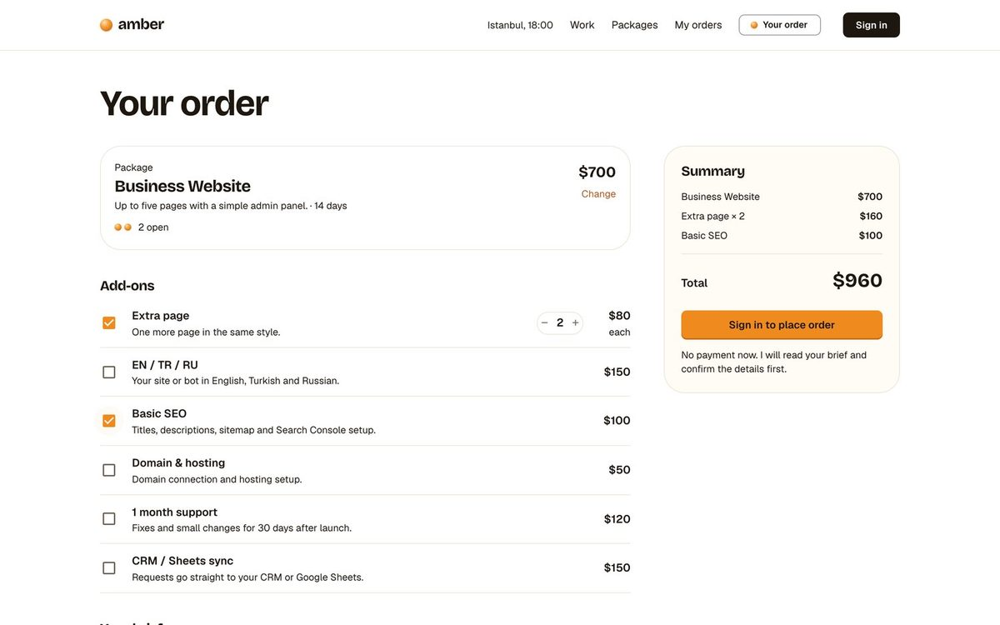
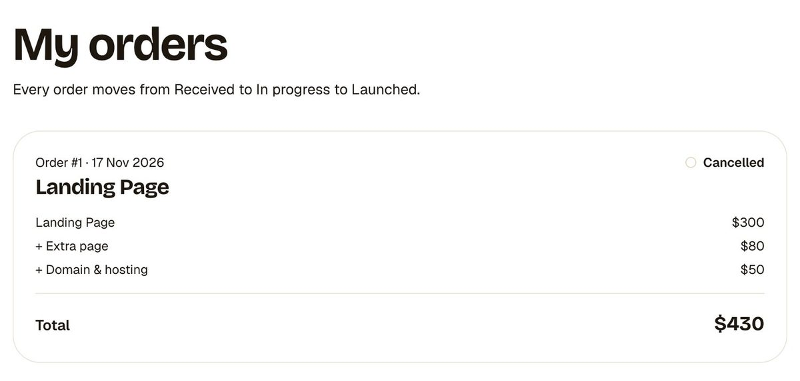
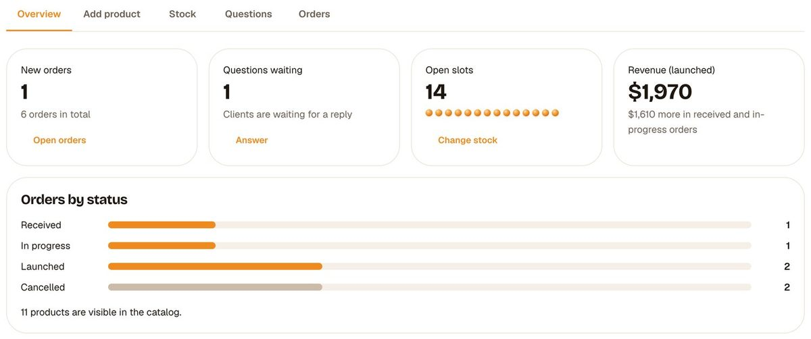

# amber

**An online shop for a one-person web studio in Istanbul.** Clients pick a service package — a landing page,
a business website, an AI chatbot, an analytics dashboard or a starter kit for hotels and cafés — add extras,
describe the project and follow the order from brief to launch.

The twist: for a solo developer the real limit is time, so **stock is the number of projects I can still take
this month**. One amber bead on the page = one open slot.



<sub>React · TypeScript · Material UI · Java 21 · Spring Boot 4 · PostgreSQL · Firebase Auth — built for the CEN301 Web Design and Programming course project.</sub>

---

## What it does

| For clients | For the studio (admin) |
|---|---|
| Browse packages with live open slots | **Overview**: orders by status, revenue, open slots, questions waiting |
| Read what each package includes, ask a question | **Add product**: packages and add-ons, with server-side validation |
| Build an order: one package + add-ons, quantities, a brief | **Stock**: change monthly slots, hide products from the catalog |
| Sign in with email or Google | **Questions**: answer them; answers become public |
| **My orders**: history with date, items, total and status | **Orders**: move along *Received → In progress → Launched*, or cancel (the slot comes back) |

| | |
|---|---|
|  |  |
| **Package page and Q&A** — answered questions are public | **Your order** — one package, add-ons, brief, live total |
|  |  |
| **My orders** — purchase history | **Admin overview** |

## How it is built

```
React app (Vite, MUI)  ──  Firebase ID token in every request
        │  HTTP + JSON
Spring Boot
  security    FirebaseTokenFilter → user + role (USER / ADMIN) in the SecurityContext; SecurityConfig URL rules
  controller  Product · Order · Question · Admin · Me — HTTP mapping and @Valid input
  service     business rules and transactions (OrderService, ProductService, QuestionService, …)
  repository  Spring Data JPA, JPQL visibility rules, entity graphs, a row lock for slots
  entity/dto  User, Product, Order, OrderItem, Question · records sent to the browser
  exception   one JSON error shape (RFC 9457) for 400 / 401 / 403 / 404 / 409
        │  JDBC
PostgreSQL
```

A few decisions worth a look:

- **Prices can't be faked.** The browser sends only product ids and quantities; `OrderService` takes prices from the
  database and copies name + price into each order line, so later catalog changes never rewrite history.
- **The last slot is safe.** Placing an order is one transaction that locks the package row
  (`SELECT … FOR UPDATE`), so two clients can't both take the last slot. Sold out → `409`.
- **Admin needs a verified email.** The role lives in the database; an account becomes `ADMIN` only if its email is in
  `ADMIN_EMAILS` *and* Firebase confirms the person owns it. `/api/admin/**` is checked in `SecurityConfig` and again
  with `@PreAuthorize`.
- **Q&A respects privacy.** Unanswered questions are visible only to their author and the admin; only first names are shown.

## Project layout

```
SourceCode/
  frontend/   React app — src/{api, auth, cart, components, hooks, pages, theme}
  backend/    Spring Boot app — application.properties included
  database/   PostgreSQL dump
docs/images/  screenshots for this page
```

## Running locally

Requirements: Java 21, Node.js 20+, PostgreSQL 16.

### 1. Database

```bash
createdb -U postgres amber
```

Tables are created by Hibernate on the first start, and the starting catalog is seeded automatically.

### 2. Back-end (port 8080)

```bash
cd SourceCode/backend
cp local.properties.example local.properties   # put the admin email(s) here
./mvnw spring-boot:run
```

Settings (all optional, with local defaults) live in `src/main/resources/application.properties`:

| Env var | Default | Purpose |
|---|---|---|
| `DB_URL`, `DB_USERNAME`, `DB_PASSWORD` | `jdbc:postgresql://localhost:5432/amber`, `postgres`, empty | Database connection |
| `FIREBASE_CREDENTIALS_PATH` | `~/.secrets/amber-firebase-adminsdk.json` | Firebase service-account key (never committed) |
| `FIREBASE_CREDENTIALS_JSON` | empty | The same key as JSON text, for hosting |
| `ADMIN_EMAILS` | empty | Comma-separated admin emails (or set in `local.properties`) |
| `CORS_ORIGINS` | `http://localhost:5173` | Front-end address allowed to call the API |
| `SEED_DEMO` | `false` | Load demo clients, orders and questions (for presentations only) |

Without the Firebase key the public catalog still works, but sign-in is disabled.

### 3. Front-end (port 5173)

```bash
cd SourceCode/frontend
npm install
npm run dev
```

Open http://localhost:5173. In development, requests to `/api` are forwarded to the back-end on port 8080.

## Tests

```bash
createdb -U postgres amber_test
cd SourceCode/backend && ./mvnw test
```

44 tests: unit tests for the order rules (`OrderServiceTest`, Mockito, no database) and integration tests for every
API area (`security`, `order`, `question`, `admin`) on a separate database, with Firebase mocked.

## Releases

Each finished phase is a tagged release: `v0.1.0` back-end foundation · `v0.2.0` sign-in · `v0.3.0` catalog and
checkout · `v0.4.0` order history and Q&A · `v0.5.0` admin panel · `v0.6.0` polish and demo data.

---

Made by Mikhail Savushkin, Istanbul.
